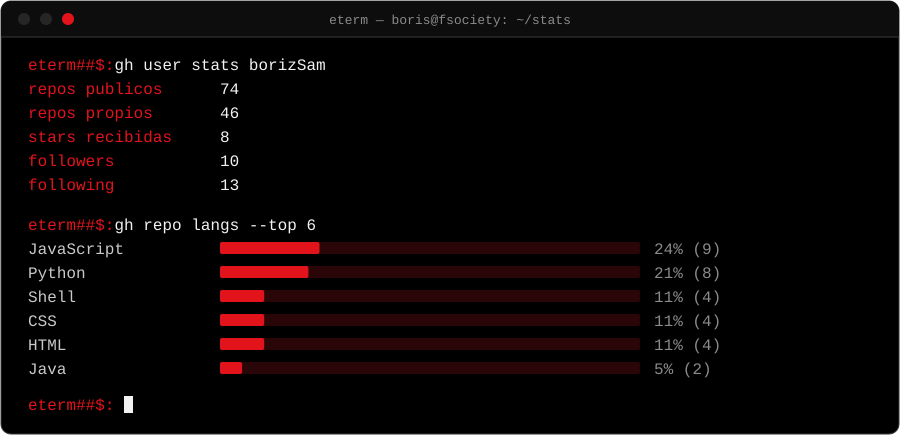

<!-- hello, friend. si estás leyendo el código fuente, ya vas bien. pista: base64 → rot13. -->
<div align="center">
  
</div>

&nbsp;

<div align="center">
  
</div>

<p align="center">
  
  
  
  
  
  
  
  
  
  
  
  
  
  
</p>

## ~/whoami

```console
eterm##$: cat whoami.yml
name:    Boris Ivan Huarachi Pérez
role:    DevOps Engineer @ OCA Global
base:    Barcelona
study:   Computer Engineering · UOC (in progress)
cert:    AWS Cloud Practitioner · AWS re/Start
next:    AWS Solutions Architect Associate
stack:   Terraform · Jenkins · Bitbucket · AWS · Azure · GCP
ops:     Zabbix · Grafana · Ansible · Docker · Kubernetes
```

I automate deployments, CI/CD and infrastructure as code, and I monitor what I ship. I come from running Linux, Windows and VMware systems in production, and what I enjoy most is taking manual work off teams’ hands.

## ~/portfolio

<p>
  <a href="https://borizsam.github.io/"></a>
  <a href="https://borizsam.github.io/assets/cv.pdf"></a>
</p>

<sub>My work, projects and CV in a terminal-style site, published with GitHub Pages.</sub>

## ~/projects

```console
eterm##$: kubectl get deployments -n proyectos
```

| NAME | STACK | WHAT IT DOES |
|------|-------|----------|
| [astro-care](https://github.com/borizSam/astro-care) | TypeScript · Real-time · NEWS2 | Offline health monitoring for Artemis astronauts (NASA Space Apps 2026): live vitals and a GO / NO-GO test. |
| [quarto-bedrock](https://github.com/borizSam/quarto-bedrock) | AWS Lambda · Bedrock · Quarto · GitHub Actions | Daily pipeline that generates a DevOps post with AI and publishes it to GitHub Pages. |
| [Aeropuerto-infra](https://github.com/borizSam/Aeropuerto-infra) | AWS ECS Fargate · Docker · GitHub Actions | Infra and CI/CD for the Aeropuerto system: Spring Boot backend and React frontend on Fargate. |
| [ci-cd-python-test-automation](https://github.com/borizSam/ci-cd-python-test-automation) | Python · Docker · GitHub Actions | Pipeline that validates every commit with automated tests: *shift-left testing*. |
| [pokemon-fastapi](https://github.com/borizSam/pokemon-fastapi) | FastAPI · Docker · pytest | REST API with CRUD, filters and Swagger, tests in CI and ready for a container. |
| [AWS-Re_Start](https://github.com/borizSam/AWS-Re_Start) | Quarto · GitHub Pages | My notes and labs from the AWS re/Start program: cloud, Linux, networking, security. |
| [RoadMapDevOps](https://github.com/borizSam/RoadMapDevOps) | Quarto · GitHub Actions · Pages | My DevOps roadmap, rendered and deployed on every push. |

&nbsp;

<div align="center">
  
</div>

## ~/stats

<div align="center">
  <a href="https://github.com/borizSam?tab=repositories">
    
  </a>
</div>

&nbsp;

<div align="center">
  
</div>

<details>
<summary><code>eterm##$: ls -lt ~/repos | head -5</code> · latest pushes</summary>

&nbsp;

<!-- RECENT:START -->
- `2026-11-25` [quarto-bedrock](https://github.com/borizSam/quarto-bedrock) · JavaScript
- `2026-11-23` [borizSam.github.io](https://github.com/borizSam/borizSam.github.io) · JavaScript
- `2026-11-21` [repolocal](https://github.com/borizSam/repolocal) · Go
- `2026-11-15` [astro-care](https://github.com/borizSam/astro-care) · TypeScript
- `2026-11-04` [skills-review-pull-requests](https://github.com/borizSam/skills-review-pull-requests) · HTML
<!-- RECENT:END -->

<sub>This list, <code>stats.svg</code> and the snake are regenerated every day by a <a href=".github/workflows/profile.yml">workflow</a>. If it has to be touched by hand twice, it gets automated.</sub>
</details>

## ~/access

<div align="center">
  
</div>

```console
eterm##$: ssh friend@boris
Permission denied (publickey).
```

There is a message for whoever gets this far. It is not hard, but it is not free either.

```text
Y2FwYSAyLzIgLT4gcm90MTM6IE5QUFJGRiBURU5BR1JRLiByZnBldm9yenIgcGJhIHJ5IG5maGFnYiBbdXJ5eWJfc2V2cmFxXSBsIHBocmFnbnpyIHBiemIgeWIgZXJmYnlpdmZnci4=
```

<sub>layer 1/2 · hint: what you see ends in <code>=</code>, and that is no coincidence.</sub>

If you solve it, you know where to find me.

## ~/contact

<p>
  <a href="https://www.linkedin.com/in/boris-ivan-huarachi-perez-859638219/">
    
  </a>
  <a href="mailto:bhuarachiperez@gmail.com">
    
  </a>
  <a href="https://borizsam.github.io/">
    
  </a>
</p>

---

<sub><code>// control is an illusion. automation is not.</code></sub>

