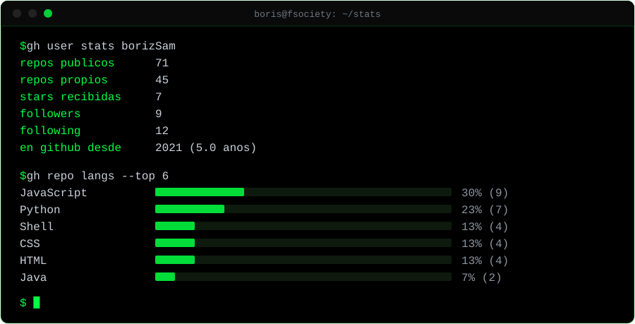

<!-- hello, friend. si estás leyendo el código fuente, ya vas bien. pista: base64 → rot13. -->
<div align="center">
  
</div>

&nbsp;

<div align="center">
  
</div>

<p align="center">
  
  
  
  
  
  
  
  
  
  
</p>

## ~/projects

```console
eterm##$: kubectl get deployments -n proyectos
```

| NAME | STACK | QUÉ HACE |
|------|-------|----------|
| [Aeropuerto-infra](https://github.com/borizSam/Aeropuerto-infra) | AWS ECS Fargate · Docker · GitHub Actions | Infra y CI/CD del sistema Aeropuerto: backend Spring Boot y frontend React desplegados en Fargate. |
| [ci-cd-python-test-automation](https://github.com/borizSam/ci-cd-python-test-automation) | Python · Docker · GitHub Actions | Pipeline que valida cada commit con tests automáticos: *shift-left testing*. |
| [pokemon-fastapi](https://github.com/borizSam/pokemon-fastapi) | FastAPI · Docker · pytest | API REST con CRUD, filtros y Swagger, tests en CI y lista para contenedor. |
| [AWS-Re_Start](https://github.com/borizSam/AWS-Re_Start) | Quarto · GitHub Pages | Mis apuntes y laboratorios del programa AWS re/Start: nube, Linux, redes, seguridad. |
| [RoadMapDevOps](https://github.com/borizSam/RoadMapDevOps) | Quarto · GitHub Actions · Pages | Mi roadmap DevOps, renderizado y desplegado solo en cada push. |
| [Stats-Server](https://github.com/borizSam/Stats-Server) | Bash · Linux | Script que saca las métricas básicas de un servidor: CPU, memoria, disco, procesos. |

&nbsp;

<div align="center">
  
</div>

## ~/stats

<div align="center">
  <a href="https://github.com/borizSam?tab=repositories">
    
  </a>
</div>

&nbsp;

<div align="center">
  
</div>

<details>
<summary><code>eterm##$: ls -lt ~/repos | head -5</code> · últimos pushes</summary>

&nbsp;

<!-- RECENT:START -->
- `2026-10-24` [repolocal](https://github.com/borizSam/repolocal) · Go
- `2026-10-23` [quarto-bedrock](https://github.com/borizSam/quarto-bedrock) · JavaScript
- `2026-10-03` [pokemon-fastapi](https://github.com/borizSam/pokemon-fastapi) · Python
- `2026-06-15` [pokeAPI](https://github.com/borizSam/pokeAPI) · JavaScript
- `2026-06-08` [artifact-download-lab](https://github.com/borizSam/artifact-download-lab)
<!-- RECENT:END -->

<sub>Esta lista, <code>stats.svg</code> y la serpiente las regenera cada día un <a href=".github/workflows/profile.yml">workflow</a>. Si hay que tocarlo a mano dos veces, se automatiza.</sub>
</details>

## ~/access

<div align="center">
  
</div>

```console
eterm##$: ssh friend@boris
Permission denied (publickey).
```

Hay un mensaje para quien llegue hasta aquí. No es difícil, pero tampoco regalado.

```text
Y2FwYSAyLzIgLT4gcm90MTM6IE5QUFJGRiBURU5BR1JRLiByZnBldm9yenIgcGJhIHJ5IG5maGFnYiBbdXJ5eWJfc2V2cmFxXSBsIHBocmFnbnpyIHBiemIgeWIgZXJmYnlpdmZnci4=
```

<sub>capa 1/2 · pista: lo que ves termina en <code>=</code>, y eso no es casualidad.</sub>

Si lo resuelves, ya sabes dónde encontrarme.

## ~/contact

<p>
  <a href="https://www.linkedin.com/in/boris-ivan-huarachi-perez-859638219/">
    
  </a>
  <a href="mailto:bhuarachiperez@gmail.com">
    
  </a>
  <a href="https://www.borisdevops.com">
    
  </a>
</p>

---

<sub><code>// control is an illusion. la automatización, no.</code></sub>

