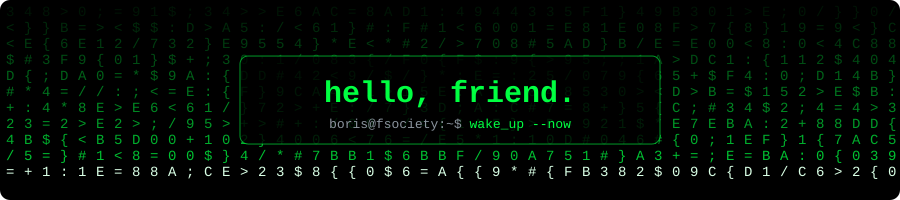
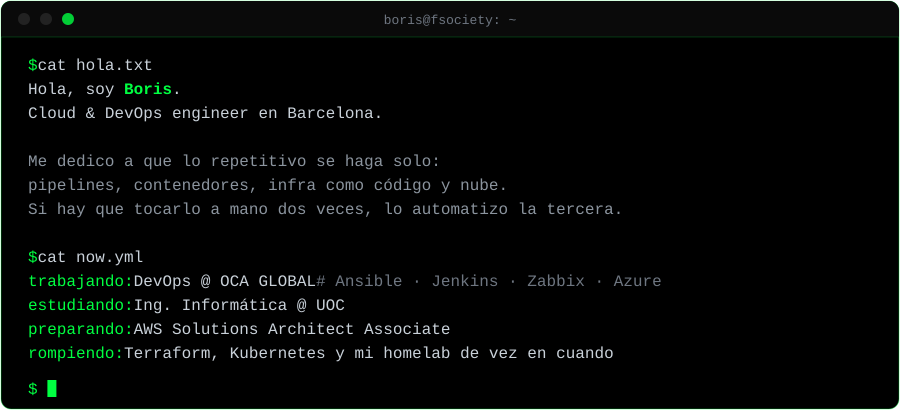

<!-- si estás leyendo el código fuente, ya vas bien. pista: base64 → rot13. -->
<div align="center">
  
</div>

&nbsp;

<div align="center">
  
</div>

&nbsp;

<div align="center">
  
</div>

&nbsp;

<p>
  
  
  
  
  
  
  
  
  
</p>

## ~/stats

<div align="center">
  <a href="https://github.com/borizSam?tab=repositories">
    
  </a>
</div>

## ~/access

```console
boris@fsociety:~$ ssh friend@boris
Permission denied (publickey).
```

Hay un mensaje para quien llegue hasta aquí. No es difícil, pero tampoco regalado.

```text
Y2FwYSAyLzIgLT4gcm90MTM6IE5QUFJGRiBURU5BR1JRLiByZnBldm9yenIgcGJhIHJ5IG5maGFnYiBbdXJ5eWJfc2V2cmFxXSBsIHBocmFnbnpyIHBiemIgeWIgZXJmYnlpdmZnci4=
```

<sub>capa 1/2 · pista: lo que ves termina en <code>=</code>, y eso no es casualidad.</sub>

Si lo resuelves, ya sabes dónde encontrarme.

## ~/contact

<p>
  <a href="https://www.linkedin.com/in/boris-ivan-huarachi-perez-859638219/">
    
  </a>
  <a href="mailto:bhuarachiperez@gmail.com">
    
  </a>
  <a href="https://www.borisdevops.com">
    
  </a>
</p>

---

<sub><code>// en la nube, o escalas… o te quedas en "pending".</code></sub>
